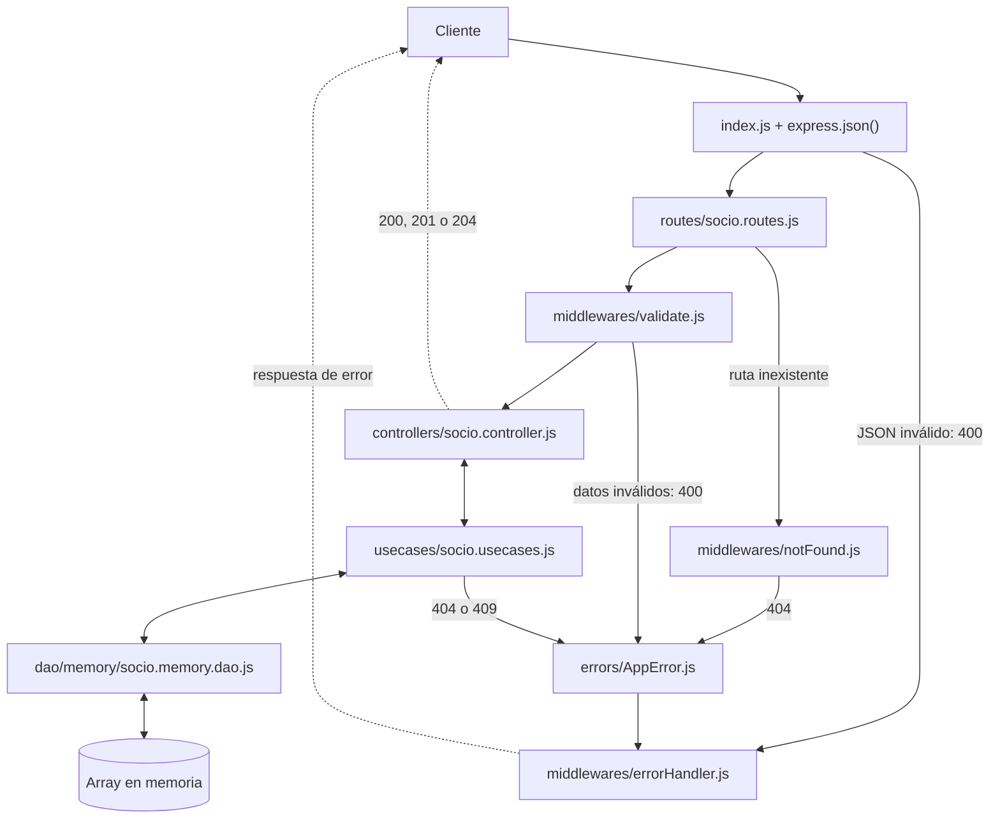
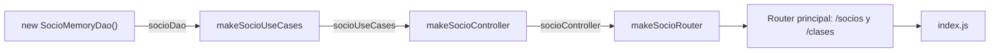

# Arquitectura de Fit.js

Fit.js es una API REST en capas: cada request baja hasta los datos y cada capa tiene una sola responsabilidad. Por ahora están implementados Socio y Clase, con persistencia en memoria.

Versión visual: [tablero en Miro](https://miro.com/app/board/uXjVERWaj4Y=/).

## Flujo de una request

Ejemplo con `POST /socios`; Clase sigue el mismo recorrido con sus propios archivos. Las flechas dobles indican que la capa llama a la siguiente y recibe el resultado.

## Qué es cada pieza

| Pieza | Qué hace | Qué no hace |
| --- | --- | --- |
| `index.js` | Arranca el servidor y fija el orden de los middlewares | No contiene lógica de negocio |
| `routes/` | Une cada verbo y URL con su validación y su controller | No tiene lógica |
| `middlewares/validate.js` | Revisa `params`, `query` y `body` con Zod y deja en `req` los datos limpios | No consulta datos guardados |
| `controllers/` | Toma los datos de `req`, llama al caso de uso y elige el status | No conoce el DAO |
| `usecases/` | Aplica las reglas de negocio, como email único o que el registro exista | No conoce HTTP ni dónde se guardan los datos |
| `dao/` | Lee y escribe los datos; si no encuentra algo, devuelve `null` | No decide errores de negocio |
| `errors/AppError.js` | Representa un error conocido con `code`, `message`, `statusCode` y `details` | No arma la respuesta HTTP |
| `middlewares/notFound.js` | Genera el 404 `ROUTE_NOT_FOUND` cuando ninguna ruta coincide | No atiende rutas existentes |
| `middlewares/errorHandler.js` | Responde todos los errores con `{ error: { code, message, details } }` | No muestra detalles internos en un 500 |

## Cómo se arma al arrancar

`container/container.js` conecta las capas en sentido inverso al de la request: crea primero lo de abajo y se lo pasa a la capa de arriba. `index.js` monta el router que devuelve. El diagrama muestra Socio; Clase se arma igual y se monta en `/clases`.

- **Inyección manual:** cada capa recibe lo que necesita en vez de crearlo.
- **Cambio de persistencia:** para pasar a SQLite se cambia el DAO en el contenedor, sin tocar los casos de uso.
- **Una sola llamada:** cada `makeContainer()` crea un DAO nuevo y vacío, por eso `index.js` lo llama una sola vez.

## Piezas de apoyo

| Pieza | Para qué sirve |
| --- | --- |
| `schemas/` | Define con Zod qué campos llegan y con qué formato. Las rutas se los pasan a `validate`. |
| `config/config.js` | Junta en un solo lugar el puerto, el tipo de persistencia y el archivo de SQLite. |
| `.env` | Guarda los valores de cada máquina y no se versiona. La plantilla es `.env.example`. |

Zod valida la forma del dato. Lo que depende de datos guardados, como el email único, va en el caso de uso.
