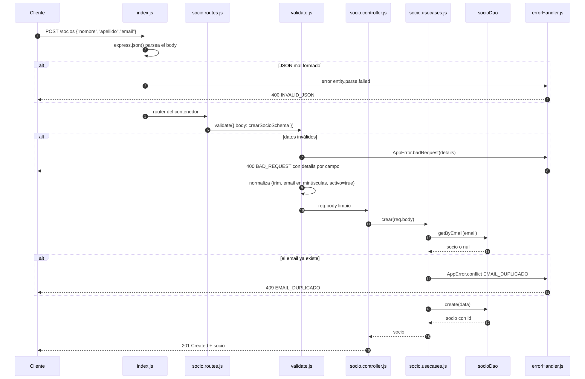
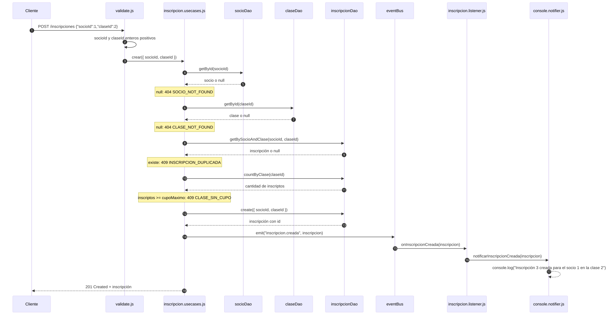
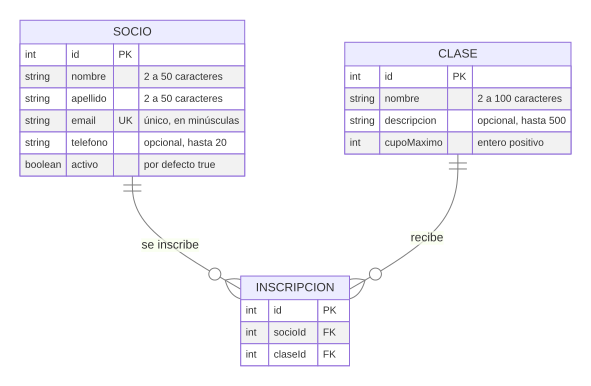

# Arquitectura de Fit.js

Fit.js es una API REST en capas para gestionar un gimnasio. Cada request atraviesa las capas de arriba hacia abajo y cada capa tiene una sola responsabilidad. Están implementados **Socio**, **Clase** e **Inscripción**, con persistencia intercambiable (memoria o SQLite), un bus de eventos para notificaciones y documentación interactiva con Swagger.

Para instalar, ejecutar y probar el proyecto, ver el [README](../README.md). Versión visual: [tablero en Miro](https://miro.com/app/board/uXjVERWaj4Y=/).

Los diagramas están como imágenes en [docs/diagramas/](diagramas/), así se ven en cualquier editor. El código Mermaid de cada diagrama está en el archivo `.mmd` del mismo nombre: para modificar uno, editá el `.mmd`, pegalo en [mermaid.live](https://mermaid.live) y exportá la imagen con *Actions → Export SVG*, reemplazando el `.svg`.

## Índice

1. [Vista general](#vista-general)
2. [Arranque del servidor](#arranque-del-servidor)
3. [Cómo se arma el contenedor](#cómo-se-arma-el-contenedor)
4. [Flujo de una request](#flujo-de-una-request)
5. [Crear una inscripción paso a paso](#crear-una-inscripción-paso-a-paso)
6. [Reglas de inscripción](#reglas-de-inscripción)
7. [Modelo de datos](#modelo-de-datos)
8. [Persistencia intercambiable](#persistencia-intercambiable)
9. [Eventos y notificaciones](#eventos-y-notificaciones)
10. [Manejo de errores](#manejo-de-errores)
11. [Qué es cada pieza](#qué-es-cada-pieza)
12. [Decisiones de diseño](#decisiones-de-diseño)

## Vista general

Las flechas indican quién llama a quién. Ninguna capa conoce a las que están por encima: los casos de uso no saben de HTTP y los DAOs no saben de reglas de negocio.

## Arranque del servidor

Qué pasa cuando se ejecuta `npm run dev` o `npm start`:

El orden en `index.js` importa: `notFound` y `errorHandler` van **al final** para atrapar lo que ninguna ruta atendió y cualquier error lanzado antes.

## Cómo se arma el contenedor

`container/container.js` conecta las capas en sentido inverso al de la request: crea primero lo de abajo y se lo pasa a la capa de arriba (inyección de dependencias manual). Recibe los DAOs ya creados por `makeDaos()`; si se llama sin argumentos, usa DAOs en memoria (así lo usan los tests).

Inscripción es el único caso de uso que recibe DAOs de otros recursos, porque necesita consultar socios y clases para aplicar sus reglas.

## Flujo de una request

Ejemplo con `POST /socios`. Clase e Inscripción siguen el mismo recorrido con sus propios archivos.

## Crear una inscripción paso a paso

Es el flujo más completo: valida contra tres DAOs, aplica tres reglas y dispara un evento.

## Reglas de inscripción

Las reglas se evalúan en este orden; la primera que falla corta el flujo.

Reglas de los otros recursos:

| Recurso | Regla | Error |
| --- | --- | --- |
| Socio | Email único al crear y al actualizar (puede conservar el suyo) | 409 `EMAIL_DUPLICADO` |
| Socio | El id tiene que existir para obtener, modificar o borrar | 404 `SOCIO_NOT_FOUND` |
| Clase | El id tiene que existir para obtener, modificar o borrar | 404 `CLASE_NOT_FOUND` |
| Inscripción | El id tiene que existir para obtener o borrar | 404 `INSCRIPCION_NOT_FOUND` |

## Modelo de datos

Un socio puede tener muchas inscripciones y una clase puede tener muchas inscripciones. La inscripción es la tabla intermedia entre ambos.

En SQLite las relaciones están definidas en `dao/models/index.js` con `onDelete: 'CASCADE'`: al borrar un socio o una clase se borran sus inscripciones. En memoria no hay cascada.

## Persistencia intercambiable

Los casos de uso dependen de un **contrato** (los métodos del DAO), no de una implementación. `dao/dao.factory.js` elige cuál crear según `PERSISTENCE_TYPE`.

| Método | Socio | Clase | Inscripción | Devuelve |
| --- | :-: | :-: | :-: | --- |
| `getAll()` | ✔ | ✔ | ✔ | Lista |
| `getById(id)` | ✔ | ✔ | ✔ | Registro o `null` |
| `getByEmail(email)` | ✔ | | | Registro o `null` |
| `getBySocioAndClase(socioId, claseId)` | | | ✔ | Registro o `null` |
| `countByClase(claseId)` | | | ✔ | Número |
| `create(data)` | ✔ | ✔ | ✔ | Registro con `id` |
| `update(id, data)` | ✔ | ✔ | | Registro o `null` |
| `delete(id)` | ✔ | ✔ | ✔ | `true` o `false` |

Los dos modos devuelven objetos planos y sin campos `null`, para que las respuestas sean iguales. `tests/persistencia.test.js` corre el mismo escenario en ambos y verifica que respondan idéntico.

Con SQLite, `dao/seed.js` carga datos de ejemplo al arrancar, solo en las tablas que estén vacías.

## Eventos y notificaciones

El contenedor crea **un único** `EventEmitter` y lo comparte con todos los casos de uso. Hoy se usa un evento:

- El caso de uso no sabe quién escucha: solo emite el evento después de guardar.
- El listener aísla los errores del notificador para que no rompan la request.
- `registerInscripcionListener` devuelve una función para desuscribirse (la usan los tests).
- Para notificar por otro medio se crea otro notificador con `notificarInscripcionCreada` y se cambia en el contenedor.

## Manejo de errores

Todos los errores terminan en `middlewares/errorHandler.js`, que responde siempre `{ error: { code, message, details } }`.

| Quién lo genera | Error |
| --- | --- |
| `express.json()` | 400 `INVALID_JSON` |
| `middlewares/validate.js` | 400 `BAD_REQUEST` con `details` por campo |
| `middlewares/notFound.js` | 404 `ROUTE_NOT_FOUND` |
| `usecases/` | 404 `*_NOT_FOUND`, 409 `EMAIL_DUPLICADO`, `INSCRIPCION_DUPLICADA`, `CLASE_SIN_CUPO` |
| Cualquier error no previsto | 500 `INTERNAL_ERROR` |

`AppError` tiene fábricas para los casos comunes: `AppError.badRequest(message, details)`, `AppError.notFound(message, code)` y `AppError.conflict(message, code)`. Express 5 pasa automáticamente al `errorHandler` los errores de los controllers `async`, por eso los controllers no necesitan `try/catch`.

## Qué es cada pieza

| Pieza | Qué hace | Qué no hace |
| --- | --- | --- |
| `index.js` | Arranca el servidor, monta Swagger, elige los DAOs, corre el seed y fija el orden de los middlewares | No contiene lógica de negocio |
| `config/config.js` | Junta en un solo lugar el puerto, el tipo de persistencia y el archivo de SQLite | No valida reglas |
| `container/container.js` | Crea y conecta DAOs, bus de eventos, casos de uso, controllers y routers; define `GET /` | No atiende requests de recursos |
| `routes/` | Une cada verbo y URL con su validación y su controller | No tiene lógica |
| `schemas/` | Define con Zod qué campos llegan y con qué formato | No consulta datos guardados |
| `middlewares/validate.js` | Revisa `params`, `query` y `body` y deja en `req` los datos limpios | No consulta datos guardados |
| `controllers/` | Toma los datos de `req`, llama al caso de uso y elige el status | No conoce el DAO |
| `usecases/` | Aplica las reglas de negocio y emite eventos | No conoce HTTP ni dónde se guardan los datos |
| `dao/dao.factory.js` | Crea los DAOs de memoria o de SQLite | No conoce las reglas |
| `dao/memory/`, `dao/sqlite/` | Leen y escriben datos; si no encuentran algo devuelven `null` | No deciden errores de negocio |
| `dao/models/index.js` | Conexión, modelos y relaciones de Sequelize | No se carga en modo memoria |
| `dao/seed.js` | Datos de ejemplo para SQLite | No pisa datos existentes |
| `listeners/` | Reaccionan a eventos del bus | No modifican datos |
| `notifiers/` | Envían la notificación (hoy, por consola) | No conocen el bus |
| `errors/AppError.js` | Representa un error conocido con `code`, `message`, `statusCode` y `details` | No arma la respuesta HTTP |
| `middlewares/notFound.js` | Genera el 404 `ROUTE_NOT_FOUND` | No atiende rutas existentes |
| `middlewares/errorHandler.js` | Responde todos los errores con el mismo formato | No muestra detalles internos en un 500 |
| `openapi.yaml` | Contrato de la API que muestra Swagger en `/api-docs` | No valida requests |
| `tests/` | Tests de integración con requests HTTP reales | No usan `fitjs.sqlite` |

## Decisiones de diseño

- **Capas con una sola responsabilidad.** Cambiar cómo se guardan los datos no toca las reglas, y cambiar una regla no toca HTTP.
- **Inyección de dependencias manual.** Cada fábrica (`make...`) recibe lo que necesita. Eso permite que los tests armen la app con los DAOs que quieran.
- **Zod valida la forma, los casos de uso validan el negocio.** Que un email tenga formato válido es de Zod; que no esté repetido depende de los datos guardados y va en el caso de uso.
- **Los DAOs devuelven `null`, los casos de uso deciden el error.** Así un "no encontrado" se traduce siempre al mismo `AppError` con el mismo `code`.
- **SQLite se importa solo si se usa.** `dao.factory.js` lo carga con `import()` dinámico para que el modo memoria no dependa de Sequelize.
- **Eventos desacoplados.** Agregar notificaciones nuevas no requiere modificar el caso de uso de inscripción.
- **Un único `makeContainer()`.** Cada llamada crea DAOs en memoria nuevos y vacíos, por eso `index.js` lo llama una sola vez.
